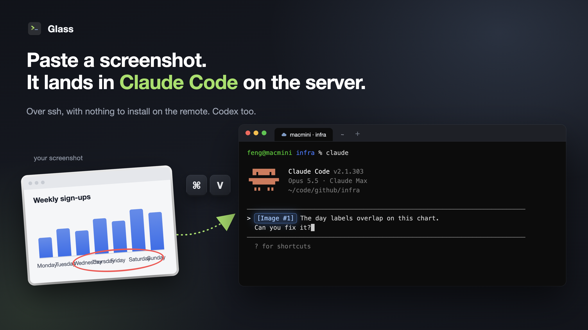
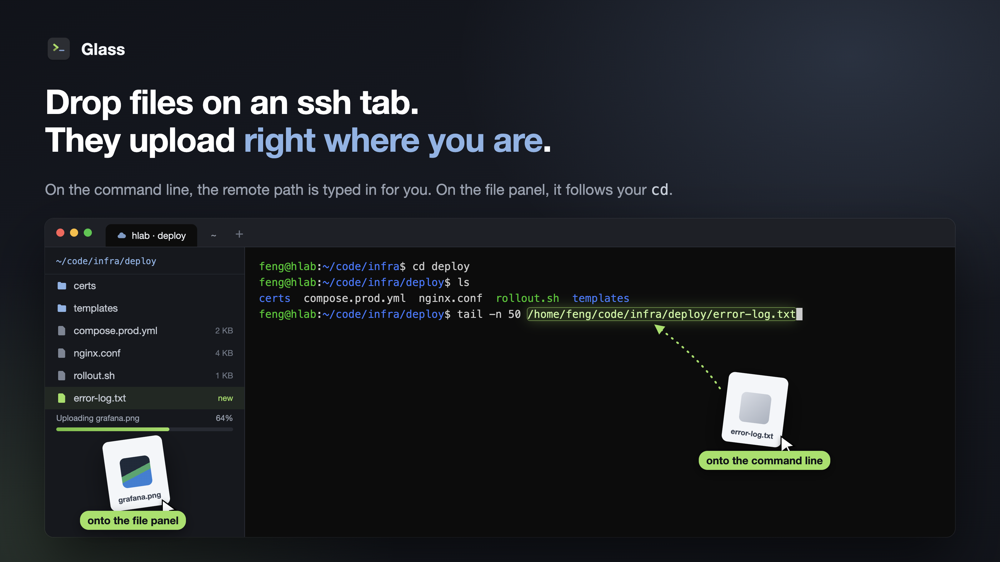
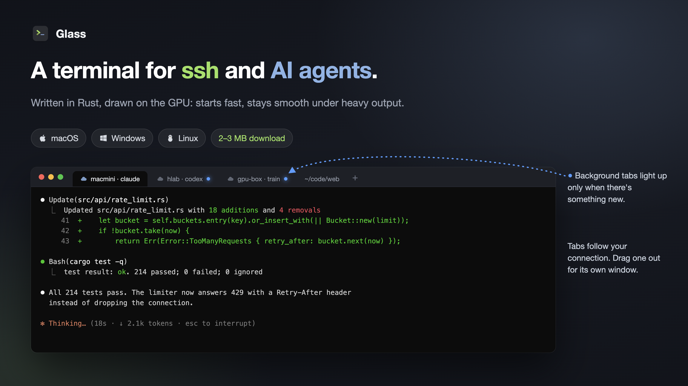
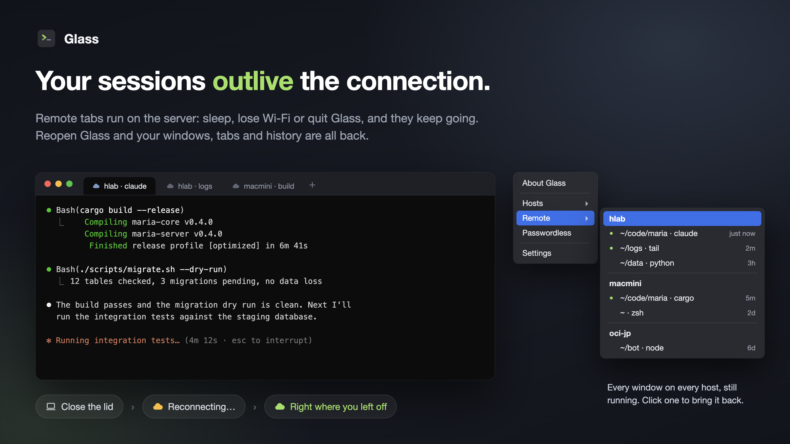

# Glass

[English](README.md) | **中文**

**为 SSH 和 AI 编程助手打造的终端。** 核心用 Rust 编写，界面由 GPU 直接绘制，启动快、刷屏和滚动顺滑、
打字没有延迟；在本机或 ssh 远端的 Claude Code、Codex 里粘贴截图，直接变成输入框里的图片附件。

支持 macOS、Windows、Linux，界面默认中文，也可以在设置里切换成英文。

> 源码目前未公开，后续会开源。这个仓库只用来发布安装包和收集反馈。

## 下载

到 [Releases](https://github.com/devfchen/glass-terminal-releases/releases) 下载最新版：

| 平台 | 文件 | 说明 |
|---|---|---|
| macOS 11+（Apple 芯片：M1 / M2 / M3 / M4） | `glass-<版本>-macos-arm64.dmg` | 打开后把 Glass 拖进"应用程序"。已经过 Apple 公证，双击即可打开 |
| macOS 11+（Intel） | `glass-<版本>-macos-x86_64.dmg` | 同上。不确定是哪种：屏幕左上角苹果菜单 → "关于本机"，"芯片"写着 Apple 的选上一个，"处理器"写着 Intel 的选这个 |
| Windows 10 1809+ / 11（x64） | `glass-<版本>-windows-x64.zip` | 解压得到单个 `glass.exe`，直接运行，不用安装运行库。exe 没有代码签名，第一次运行时 SmartScreen 点"更多信息 → 仍要运行" |
| Windows 11 ARM64 | `glass-<版本>-windows-arm64.zip` | 同上 |
| Linux x86_64（glibc 2.35+，X11 / Wayland） | `glass-<版本>-linux-x86_64.tar.gz` | 解压后按包里的 `README.md` 装到 `~/.local`；需要 Vulkan 驱动（Mesa 或 NVIDIA） |

`SHA256SUMS.txt` 是各文件的校验和。

## 为什么用 Glass

- **快**：Rust 编写，基于 Zed 编辑器的 GPUI 框架用 GPU 绘制，终端内核是 alacritty_terminal；大量输出、
  快速滚动都很流畅，安装包只有两三 MB。
- **粘贴很顺**：截图、浏览器里复制的图片、Finder / 资源管理器里复制的文件，在本机标签里直接用，在 ssh
  标签里自动传到远端再填入远端路径；前台是 Claude Code / Codex 时显示为 `[Image #1]` 附件。远端什么都
  不用装，走系统自带的 OpenSSH。
- **拖文件上传**：把文件拖进 ssh 标签，直接传到终端当前所在的目录，保留原文件名，并把远端路径填进命令行；重名自动改名不覆盖。
- **断线不丢**：从"远端"菜单开的标签（带云图标）跑在主机上的 tmux 里，电脑睡眠、断网、退出 Glass 都不影响，
  网络回来自动重连，屏幕和历史都在；"远端"菜单列出每台主机上的所有窗口，点一下就接回来。退出 Glass 再打开，
  窗口、标签、目录和回滚内容都会恢复。
- **文件面板**（⌘B / Alt+B）：侧栏浏览远端文件，拖进去上传、右键下载，跟着终端的 `cd` 走，有进度、能取消。
- **为 AI 助手调好的键盘**：支持 kitty 键盘协议，Claude Code / Codex 里 Shift+Enter 换行、Enter 提交；
  ⌘ / Ctrl 点击打开链接，包括程序发出的跨行链接。
- **密码也能用，免密一键设好**：只能输密码的电脑，传图、拖文件、文件面板会弹窗要密码，可以记住；
  Glass 菜单里点"免密"，自动生成或复用密钥、装到远端，并把这台电脑加进"远程"菜单，以后一点就连上。
- **配色方案**：内置 Light、Dark（与 Windows Terminal 默认配色一致），可以新增自己的方案，颜色用取色板调；
  界面跟着方案变深变浅。
- **好用的标签和窗口**：Windows / Linux 上标签直接放在标题栏里（像 Windows Terminal），标签跟着当前目录显示；新标签跟随当前连接，标签可以拖出成独立窗口、拖回合并；mac 上标签栏高度可调；会话管理器管理
  `~/.ssh/config` 里的主机；中文输入法（微软拼音、搜狗等）组字、选词就在光标处。

## 运行要求

- **macOS**：11 及以上，用系统自带的 ssh。
- **密码存在哪**：选了"记住密码"的，存在 Glass 自己的 `passwords.toml`（和设置文件同一个文件夹）。macOS / Linux
  上只有你的账户能读、不加密；Windows 上用系统 DPAPI 加密。删掉主机或这个文件，密码就没了。
- **Windows**：10 1809 及以上。远端标签和传图用系统自带的 OpenSSH 客户端（被删掉的话在"设置 > 可选功能"
  里加回"OpenSSH 客户端"）。只能输密码的主机会弹窗要密码，也可以用 Glass 菜单里的"免密"一键设好密钥登录；
  私钥有口令时，把"OpenSSH Authentication Agent"服务设为自动并 `ssh-add` 一次。不要以管理员身份运行，
  否则收不到资源管理器拖来的文件。
- **Linux**：glibc 2.35 以上（Ubuntu 22.04、Debian 12 及更新）、Vulkan 驱动、`ssh`。
- **远端**：不装任何东西，有 POSIX `sh` 即可（Linux、macOS、BSD）；文件面板要远端开着 SFTP（OpenSSH 默认开）；远端标签要主机上有 tmux 3.0 或更新。

## 反馈

遇到问题、想要的功能，欢迎在 [Issues](https://github.com/devfchen/glass-terminal-releases/issues) 里提，
附上系统版本、Glass 版本（"关于 Glass"）和截图会更快定位。

## 第三方组件

Glass 构建在这些开源项目之上，按各自的许可证使用：

| 组件 | 用途 | 许可证 |
|---|---|---|
| [GPUI](https://github.com/zed-industries/zed)（Zed Industries） | 界面框架、GPU 渲染 | Apache-2.0，**有修改**：Windows 输入法修复、拖出标签时移动窗口、一行里换字体时的排版修复、mac 改窗口标题时鼠标指针不闪 |
| [alacritty_terminal](https://github.com/alacritty/alacritty)（Alacritty） | 终端内核 | Apache-2.0，**有修改**：kitty 键盘模式栈满时不再崩溃（同上游修复） |
| [vte](https://github.com/alacritty/vte) | 控制序列解析 | Apache-2.0 / MIT |
| [ConPTY / OpenConsole](https://github.com/microsoft/terminal)（Microsoft，仅 Windows 版） | 伪终端 | MIT，未修改 |
| 其余约 600 个 Rust 库 | 图片解码、字体、序列化、平台接口等 | MIT、Apache-2.0、BSD、ISC、Zlib、MPL-2.0 等 |

完整清单和每个组件的许可证全文见 [THIRD_PARTY_LICENSES.md](THIRD_PARTY_LICENSES.md)，每个安装包里也附有一份
（mac 在 `Glass.app/Contents/Resources/`，Windows、Linux 在压缩包里）。Glass 通过系统自带的 OpenSSH 程序连接
远端，不包含也不链接 OpenSSH。

© 2026 Feng Chen
